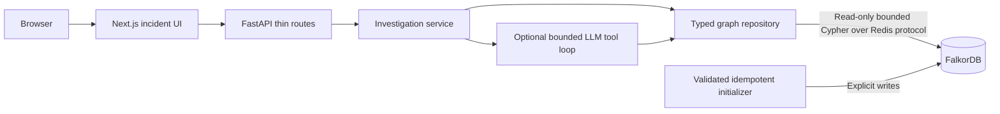

# GraphOps architecture

Reviewed October 14, 2026 against `fc9739d50a025662ae208807e96781d12db6affd`.
This is the target architecture; only the scaffold described in
[the foundation review](FOUNDATION_REVIEW.md) currently exists. Acceptance follows
[TASKS.md](TASKS.md), in order.

## Stack and responsibilities

Keep three local services: FalkorDB, FastAPI, and Next.js App Router. FalkorDB is
the only domain datastore. No queue, vector store, agent framework, or external
ingestion service is needed for the MVP. Docker Compose is the canonical runtime;
optional LLM credentials remain server-side.

Routes validate requests, invoke services, and return Pydantic models. Put driver
lifecycle/configuration in `backend/app/core/`, query execution and conversion in
`backend/app/graph/`, orchestration in `services/`, and tools/prompts/LLM integration
in `agent/`. Reusable Cypher has one authoritative copy in `graph/queries/`.
Tests live in `backend/tests/`. Avoid runtime import-path mutation.

## Infrastructure and readiness

Manage the official Python client through FastAPI lifespan and close its pool at
shutdown. Use the supported async interface or a bounded threadpool for blocking
graph/LLM I/O; a coroutine containing synchronous calls is not sufficient.
Bound connection, socket, query, request, and tool-loop timeouts and concurrency.
Missing required packages fail startup clearly. Invalid CORS configuration fails
validation rather than becoming an arbitrary allowed-origin string.

Liveness (`GET /health/live`) indicates that the process responds. Readiness
(`GET /health/ready`, with `/health` as its compatibility alias) requires actual
read-only Cypher capability and successful schema/seed initialization validation.
Return 503 before initialization or during graph failure, and recover after graph
capability returns. Ordinary Redis `PING` is not graph readiness. Investigation
graph failures return a dependency error; no fabricated success is permitted.

Pin and record compatible server/client versions only after live verification.
Use a root backend build context to include `backend/` and `graph/` assets. Build
the frontend with `npm ci` and its committed lockfile, then run a production
server. Lock Python dependencies, exclude local artifacts/secrets with appropriate
`.dockerignore` files, and use supported Node/Next/React/ESLint/types together.
Bind published demo ports to `127.0.0.1`. Canonical Compose uses image contents,
not host source mounts; reload and bind mounts belong in an optional dev override.

Forward documented settings explicitly in Compose. Browser requests use a
browser-reachable URL such as `http://localhost:8000`; server-side Next.js requests
use `http://backend:8000` on the Compose network. Public build-time configuration
must be passed at build time when required. Never expose keys through
`NEXT_PUBLIC_*`. Add backend/frontend healthchecks and dependency ordering.

Initialization validates fixtures before writes, creates supported indexes, seeds
idempotently, and verifies identity/schema invariants before readiness. Configure
FalkorDB persistence explicitly, inspect its effective configuration, and prove
restart survival with an extra record distinct from fixture records. A volume or
recreated seed alone does not establish persistence. Routine startup never erases
the graph; an explicit reset is constrained to the designated demo graph.

## Why FalkorDB is essential
