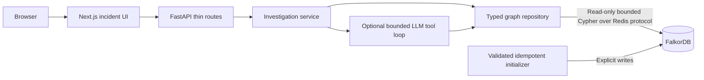

# GraphOps architecture

Reviewed October 14, 2026 against `fc9739d50a025662ae208807e96781d12db6affd`.
This is the target architecture; only the scaffold described in
[the foundation review](FOUNDATION_REVIEW.md) currently exists. Acceptance follows
[TASKS.md](TASKS.md), in order.

## Stack and responsibilities

Keep three local services: FalkorDB, FastAPI, and Next.js App Router. FalkorDB is
the only domain datastore. No queue, vector store, agent framework, or external
ingestion service is needed for the MVP. Docker Compose is the canonical runtime;
optional LLM credentials remain server-side.



Routes validate requests, invoke services, and return Pydantic models. Put driver
lifecycle/configuration in `backend/app/core/`, query execution and conversion in
`backend/app/graph/`, orchestration in `services/`, and tools/prompts/LLM integration
in `agent/`. Reusable Cypher has one authoritative copy in `graph/queries/`.
Tests live in `backend/tests/`. Avoid runtime import-path mutation.

## Infrastructure and readiness

Manage the official Python client through FastAPI lifespan and close its pool at
shutdown. Use the supported async interface or a bounded threadpool for blocking
graph/LLM I/O; a coroutine containing synchronous calls is not sufficient.
Bound connection, socket, query, request, and tool-loop timeouts and concurrency.
Missing required packages fail startup clearly. Invalid CORS configuration fails
validation rather than becoming an arbitrary allowed-origin string.

Liveness (`GET /health/live`) indicates that the process responds. Readiness
(`GET /health/ready`, with `/health` as its compatibility alias) requires actual
read-only Cypher capability and successful schema/seed initialization validation.
Return 503 before initialization or during graph failure, and recover after graph
capability returns. Ordinary Redis `PING` is not graph readiness. Investigation
graph failures return a dependency error; no fabricated success is permitted.

Pin and record compatible server/client versions only after live verification.
Use a root backend build context to include `backend/` and `graph/` assets. Build
the frontend with `npm ci` and its committed lockfile, then run a production
server. Lock Python dependencies, exclude local artifacts/secrets with appropriate
`.dockerignore` files, and use supported Node/Next/React/ESLint/types together.
Bind published demo ports to `127.0.0.1`. Canonical Compose uses image contents,
not host source mounts; reload and bind mounts belong in an optional dev override.

Forward documented settings explicitly in Compose. Browser requests use a
browser-reachable URL such as `http://localhost:8000`; server-side Next.js requests
use `http://backend:8000` on the Compose network. Public build-time configuration
must be passed at build time when required. Never expose keys through
`NEXT_PUBLIC_*`. Add backend/frontend healthchecks and dependency ordering.

Initialization validates fixtures before writes, creates supported indexes, seeds
idempotently, and verifies identity/schema invariants before readiness. Configure
FalkorDB persistence explicitly, inspect its effective configuration, and prove
restart survival with an extra record distinct from fixture records. A volume or
recreated seed alone does not establish persistence. Routine startup never erases
the graph; an explicit reset is constrained to the designated demo graph.

## Why FalkorDB is essential

The target model in [GRAPH_SCHEMA.md](GRAPH_SCHEMA.md) permits this evidence path:

```text
Incident --AFFECTED--> checkout --DEPENDS_ON--> payment --DEPENDS_ON--> Redis
payment --DEPLOYED_BY--> deployment --TRIGGERED_BY--> pipeline run
pipeline run --TRIGGERED_BY--> commit --BELONGS_TO--> repository
commit --AUTHORED_BY--> developer
earlier Incident --AFFECTED--> payment
earlier Incident --CAUSED_BY--> verified RootCause --RESOLVED_BY--> proven Fix
```

Cypher must retrieve dependency paths, filter changes by environment/time, and
match genuinely earlier resolved incidents on relevant services. Python may
format and score those results. A Python graph copy is outside scope. This path
is a design example until live tests demonstrate it; no latency is claimed.

## Investigation and evidence contract

Start with the deterministic graph-backed flow before adding AI:

1. Fetch the incident and observed affected services.
2. Traverse outgoing dependencies upstream and incoming dependencies for downstream
   impact, with bounded hops/rows and environment filtering.
3. Include changes on the symptom service itself and dependencies in an explicit
   inclusive window `[incident_time - window, incident_time]`; exclude future and
   unrelated changes. Preserve candidates missing optional ownership/author data.
4. Retrieve actual provenance and historical cause/fix paths. Earlier resolved
   matches require compatible symptoms/categories and an explained relevance rank.
5. Compare candidates, missing evidence, and competing hypotheses. Return evidence,
   path references, recommended action, and explained confidence as an evidence
   score, not a probability. Deployment recency alone is correlation.

Nodes and edges use stable application IDs. Paths contain ordered node/edge
sequences and actual traversal directions; the frontend cannot infer edges from
adjacent cards. Evidence entries identify supporting facts and their origin.
Statuses distinguish supported hypotheses, ambiguity, and insufficient evidence;
execution mode distinguishes deterministic and LLM-assisted results. API errors
distinguish unknown incidents (404), invalid arguments (422), and graph dependency
failure (503). Successful responses never imply confirmed active-incident causes.

## Optional grounded AI

Use a small typed tool loop for incident context, dependencies, recent changes,
and historical fixes through the repository. The LLM cannot submit Cypher or shell
commands. Keep bounded calls, output sizes, and timeouts. Treat graph text,
commit messages, diffs, and logs as untrusted data, not instructions.

Validate structured output and referenced entities/paths against retrieved data.
A valid evidence ID does not validate an arbitrary claim: check actual factual
support and action prerequisites. Prefer synthesis from validated fact records
and an allowlisted recommendation catalog when free-form entailment cannot be
reliably checked. Unsupported/fabricated output is rejected. Missing LLM settings,
timeouts, or invalid output produce a labelled deterministic explanation with a
fallback reason. Graph unavailability produces 503 instead of fallback evidence.

Investigation is read-only using the official client's read-only mechanism
([client](https://github.com/FalkorDB/falkordb-py),
[GRAPH.RO_QUERY](https://docs.falkordb.com/commands/graph.ro-query)). Writes are
limited to initialization and a future explicitly recorded operator resolution.
No rollback execution, developer contact, or automatic cause/fix writeback.

## Scope and validation

Finish checkout → payment → Redis with an earlier resolved incident, an unrelated
deployment, and a competing candidate first. Schema drift and recurring deadlock
follow a working primary flow. Use one directed graph library (React Flow is the
planned choice), prioritize evidence readability, and support keyboard controls
and honest loading/empty/ambiguity/failure/fallback states.

Live FalkorDB tests, a complete API investigation, frontend checks, Compose checks,
and a fresh isolated-volume launch/restart are required. Never delete existing
user volumes. CI explicitly requested live tests must fail if their database is
unavailable. Kubernetes/Jenkins/GitHub integrations, streaming, vector search,
multi-agent coordination, and autonomous remediation are deferred.
