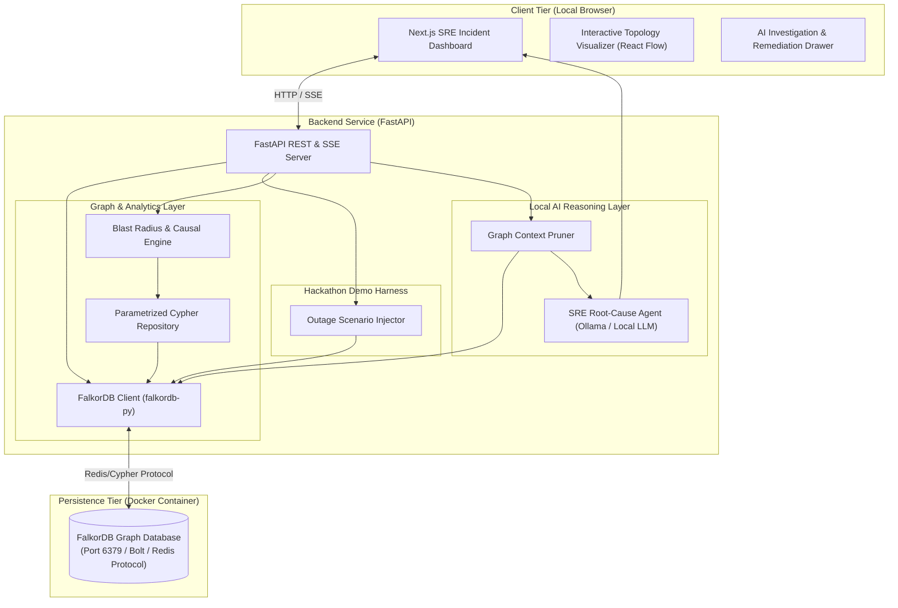
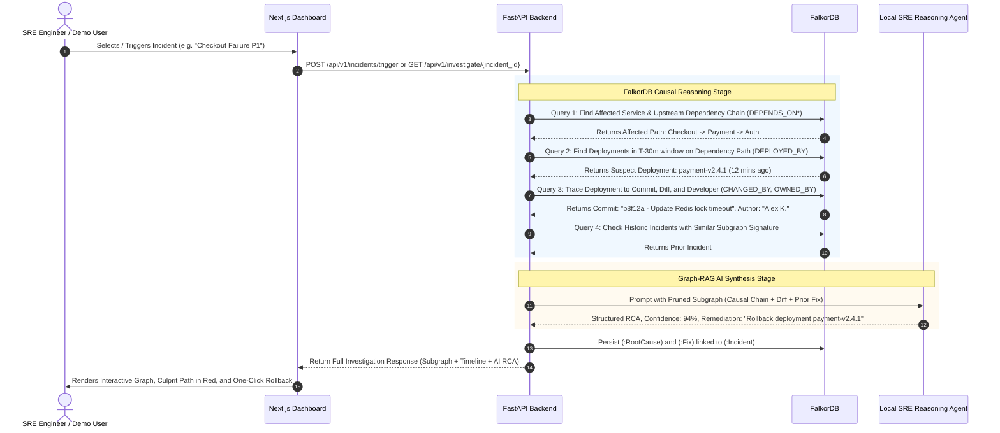

# GraphOps — MVP Architecture Specification

> **AI-Powered SRE Incident Investigation System using FalkorDB**  
> *Targeted for the FalkorDB Hackathon (4-Day Sprint & 100% Local Docker Deployment)*

---

## 1. Problem Statement & Motivation

During site reliability engineering (SRE) incidents, Mean Time to Detect (MTTD) is usually minutes, but **Mean Time to Resolution (MTTR) stretches into hours**. The bottleneck is root-cause correlation across fragmented operational silos:
- Microservices depend on deep, multi-tier dependency chains (`Service A -> Service B -> Service C`).
- Code changes, configuration updates, and deployments happen continuously across multiple repositories and teams.
- When an incident strikes (e.g., HTTP 500 spike or latency explosion), on-call engineers must manually cross-reference Prometheus alerts, GitHub PRs, ArgoCD deployment timestamps, and service dependency docs.

### Why FalkorDB is Essential to Reasoning
Relational and pure vector databases fail at topology-aware causal investigation:
1. **Multi-Hop Dependency Traversal:** FalkorDB computes upstream/downstream blast radius across N-tier dependencies in sub-millisecond time using its high-performance C-based Cypher engine.
2. **Causal Time-Window Graph Traversal:** FalkorDB correlates an `Incident` on `Service A` with recent `Deployments` and `Commits` on upstream `Service C` within a temporal window.
3. **Graph-Augmented SRE Agent (Graph RAG):** Instead of dumping massive raw log dumps into an LLM context, FalkorDB extracts the exact **causal subgraph** (culprit commit, author, deployment, service chain). The LLM reasons over the pruned, structured topology to produce verifiable Root Cause Analysis (RCA) and actionable remediation steps.
4. **Knowledge Retention & Historic RCA:** Once an incident is resolved, FalkorDB stores the `(:Incident)-[:CAUSED_BY]->(:RootCause)` and `[:RESOLVED_BY]->(:Fix)` relationships. Future incidents query past structural patterns for instant remediation runbooks.

---

## 2. High-Level Architecture Diagram



---

## 3. Core Component Design

### 3.1 Frontend (`frontend/` — Next.js 14 / App Router)
- **Incident Cockpit:** Real-time feed of active and resolved incidents with severity badges (P1–P4), affected services, and start times.
- **Topology Explorer (React Flow):** Visual graph representation of microservices, highlighting:
  - Normal nodes (Green / Muted)
  - Degraded / Impacted nodes (Amber / Red pulse)
  - Suspect deployment and commit nodes linked directly into the visual canvas
  - Blast-radius highlight path
- **Investigation Drawer & AI Assistant:**
  - Automated investigation timeline: Alert triggered → Culprit deployment isolated → Git commit identified → Author contacted.
  - LLM-generated Root Cause Analysis summary with confidence score.
  - Actionable Remediation button (e.g. `Run Rollback: helm rollback payment-service v2.1.0`).
- **Interactive Scenario Trigger:** A hackathon demo bar allowing judges to trigger 3 canned microservice outage scenarios with 1 click.

### 3.2 Backend (`backend/` — FastAPI / Python 3.11)
- **Modular Directory Layout:**
  ```text
  backend/app/
  ├── api/v1/
  │   ├── incidents.py    # Trigger, inspect, and list incidents
  │   ├── topology.py     # Subgraph extraction for visualization
  │   ├── investigate.py  # Causal chain analysis & AI RCA execution
  │   └── scenarios.py    # Hackathon demo scenario injection
  ├── core/
  │   ├── config.py       # Pydantic Settings (DB host, port, LLM endpoints)
  │   └── falkordb.py     # Connection pool & lifecycle management
  ├── graph/
  │   ├── queries.py      # Cypher queries (Blast radius, causal chains, historic RCA)
  │   ├── schema.py       # Index definitions & constraint setup
  │   └── loader.py       # Topology seeder
  ├── agent/
  │   ├── prompt.py       # Graph-to-Prompt structured context formatter
  │   └── rca_agent.py    # Local LLM caller (Ollama/OpenAI compatible)
  └── main.py             # FastAPI entrypoint, lifespan, CORS
  ```

### 3.3 Database Layer (`graph/` & FalkorDB Container)
- Official Docker image: `falkordb/falkordb:latest` (Exposes port `6379`).
- Redis-compatible Cypher engine with ultra-fast graph traversal in C.
- Python client: `falkordb` library (`from falkordb import FalkorDB`).
- Pre-loaded indexes on `Service(name)`, `Incident(id)`, `Deployment(id)`, `Commit(sha)`.

---

## 4. End-to-End Incident Investigation Lifecycle



---

## 5. Hackathon Outage Scenarios (Demo Ready)

To ensure a showstopping demo, GraphOps ships with **3 pre-packaged SRE scenarios**:

| Scenario ID | Name | Injected Fault | FalkorDB Traversal Chain |
| :--- | :--- | :--- | :--- |
| **SCENARIO-1** | **The Bad Config Deployment** | Memory limit halved in Helm chart 15m before traffic spike. | `Incident[P1] -> OrderService -> Dep[v1.4] -> Commit[#e31a] -> Dev[Dave]` |
| **SCENARIO-2** | **Deep Upstream Schema Drift** | Auth service changed token payload format; breaks downstream Cart Service. | `Incident[P1] -> CartService -[:DEPENDS_ON]-> AuthService -> Dep[v2.0] -> Commit[#9f2c]` |
| **SCENARIO-3** | **Known Recurring Regression** | Deadlock in Payment gateway previously seen 3 weeks ago. | `Incident[P2] -> PaymentService -> Match Historic Incident #42 -> Prior Fix Auto-suggested` |

---

## 6. Docker Deployment Architecture

All components run locally via `docker-compose.yml` with zero cloud dependencies:

```yaml
services:
  falkordb:
    image: falkordb/falkordb:latest
    container_name: graphops-falkordb
    ports:
      - "6379:6379"
    volumes:
      - falkordb_data:/data
    healthcheck:
      test: ["CMD", "redis-cli", "ping"]
      interval: 5s
      timeout: 3s
      retries: 5

  backend:
    build: ./backend
    container_name: graphops-backend
    ports:
      - "8000:8000"
    environment:
      - FALKORDB_HOST=falkordb
      - FALKORDB_PORT=6379
      - FALKORDB_GRAPH=graphops
      - OLLAMA_HOST=http://host.docker.internal:11434
    depends_on:
      falkordb:
        condition: service_healthy

  frontend:
    build: ./frontend
    container_name: graphops-frontend
    ports:
      - "3000:3000"
    environment:
      - NEXT_PUBLIC_API_URL=http://localhost:8000
    depends_on:
      - backend
```

---

## 7. Architectural Decisions & Guardrails

1. **FalkorDB as the Single Source of Truth:** No secondary relational DB for metadata. All services, deployments, telemetry relations, and incident records live inside FalkorDB.
2. **Local AI Execution:** Uses Ollama (e.g. `llama3:8b` or `phi3:mini`) or fallback to mock reasoning mode so the demo never fails if the internet or API keys drop during evaluation.
3. **Deterministic Cypher First, LLM Second:** The graph traversal algorithm isolates the suspect nodes deterministically; the LLM is only used for natural language explanation and synthesis, eliminating hallucination.
4. **Idempotent Seed Scripts:** Running seed routines will wipe and recreate the graph cleanly so judges can reset the demo in seconds.
