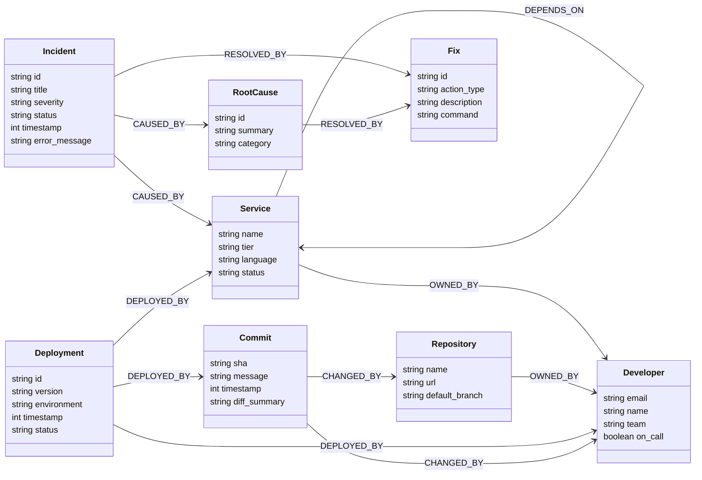

# GraphOps — FalkorDB Graph Schema Specification

This document defines the formal ontology, node models, relationship semantics, index constraints, and production Cypher queries for the **GraphOps** SRE incident investigation engine.

---

## 1. Graph Overview & Ontology Model



---

## 2. Node Specifications

### 2.1 `Service`
Represents an operational microservice, database, cache, or gateway.
| Property | Type | Required | Description | Example |
| :--- | :--- | :--- | :--- | :--- |
| `name` | String | Yes (Unique) | Canonical service identifier | `"checkout-service"` |
| `tier` | String | Yes | Criticality tier (`tier-0`, `tier-1`, `tier-2`) | `"tier-0"` |
| `language` | String | No | Language/runtime | `"golang"` |
| `status` | String | Yes | Health state (`healthy`, `degraded`, `outage`) | `"degraded"` |

### 2.2 `Repository`
Source code repository containing service source code and configuration.
| Property | Type | Required | Description | Example |
| :--- | :--- | :--- | :--- | :--- |
| `name` | String | Yes (Unique) | Git repository slug | `"org/checkout-service"` |
| `url` | String | Yes | Clone / GitHub URL | `"https://github.com/org/checkout-service"` |
| `default_branch`| String | Yes | Main branch | `"main"` |

### 2.3 `Commit`
A Git commit that changed code or deployment manifests.
| Property | Type | Required | Description | Example |
| :--- | :--- | :--- | :--- | :--- |
| `sha` | String | Yes (Unique) | Full or short git SHA | `"b8f12a4"` |
| `message` | String | Yes | Commit headline | `"fix: adjust redis lock TTL"` |
| `timestamp` | Integer | Yes | Unix epoch seconds | `1728841200` |
| `diff_summary`| String | No | High-level summary of code/config diff | `"values.yaml: memory.limit 2Gi -> 1Gi"` |

### 2.4 `Developer`
Engineers responsible for maintaining code, deploying artifacts, and on-call rotation.
| Property | Type | Required | Description | Example |
| :--- | :--- | :--- | :--- | :--- |
| `email` | String | Yes (Unique) | Corporate email | `"sarah.chen@company.com"` |
| `name` | String | Yes | Full name | `"Sarah Chen"` |
| `team` | String | Yes | Engineering squad | `"Core Payments"` |
| `on_call` | Boolean | Yes | Current on-call status | `true` |

### 2.5 `Deployment`
A deployed release artifact in an environment.
| Property | Type | Required | Description | Example |
| :--- | :--- | :--- | :--- | :--- |
| `id` | String | Yes (Unique) | Unique deployment run identifier | `"deploy-checkout-v2.4.1"` |
| `version` | String | Yes | Semantic version or image tag | `"v2.4.1"` |
| `environment`| String | Yes | Target env (`production`, `staging`) | `"production"` |
| `timestamp` | Integer | Yes | Deployment completion Unix timestamp | `1728841450` |
| `status` | String | Yes | Outcome (`SUCCESS`, `FAILED`, `ROLLED_BACK`) | `"SUCCESS"` |

### 2.6 `Incident`
An active or historic SRE alert/outage ticket.
| Property | Type | Required | Description | Example |
| :--- | :--- | :--- | :--- | :--- |
| `id` | String | Yes (Unique) | Incident identifier | `"INC-4091"` |
| `title` | String | Yes | High-level summary of failure | `"HTTP 500 error rate > 15% on Checkout"` |
| `severity` | String | Yes | Priority level (`P1`, `P2`, `P3`, `P4`) | `"P1"` |
| `status` | String | Yes | State (`TRIGGERED`, `INVESTIGATING`, `RESOLVED`) | `"INVESTIGATING"` |
| `timestamp` | Integer | Yes | Detection time in Unix epoch | `1728842100` |
| `error_message`| String | No | Primary error log or stack snippet | `"RedisTimeoutException: Connection pool exhausted"` |

### 2.7 `RootCause`
The diagnosed underlying reason for an incident.
| Property | Type | Required | Description | Example |
| :--- | :--- | :--- | :--- | :--- |
| `id` | String | Yes (Unique) | RCA identifier | `"rca-4091"` |
| `summary` | String | Yes | Technical cause of the outage | `"Connection pool starvation due to reduced memory limit"` |
| `category` | String | Yes | Category (`CONFIG_ERROR`, `DEADLOCK`, `SCHEMA_DRIFT`) | `"CONFIG_ERROR"` |

### 2.8 `Fix`
Remediation action taken or recommended to resolve an incident.
| Property | Type | Required | Description | Example |
| :--- | :--- | :--- | :--- | :--- |
| `id` | String | Yes (Unique) | Remediation ID | `"fix-4091"` |
| `action_type` | String | Yes | Type (`ROLLBACK`, `RESTART`, `CONFIG_PATCH`) | `"ROLLBACK"` |
| `description` | String | Yes | Detailed operator steps | `"Roll back deployment checkout-v2.4.1 to v2.4.0"` |
| `command` | String | No | Runnable CLI command | `"kubectl rollout undo deployment/checkout-service"` |

---

## 3. Relationship Specifications

| Relationship | Source Node | Target Node | Properties | Semantic Meaning |
| :--- | :--- | :--- | :--- | :--- |
| `DEPENDS_ON` | `Service` | `Service` | `protocol`, `critical` (bool) | Service calls another service synchronously or asynchronously. |
| `OWNED_BY` | `Service` | `Developer` | `role` (`primary`, `backup`) | Team/engineer responsible for service maintenance. |
| `OWNED_BY` | `Repository` | `Developer` | `role` | Code repository primary owner. |
| `CHANGED_BY` | `Commit` | `Developer` | `timestamp` | Developer who authored the commit. |
| `CHANGED_BY` | `Commit` | `Repository` | `branch` | Repository where commit was merged. |
| `DEPLOYED_BY`| `Deployment` | `Service` | `namespace` | Target service updated by deployment. |
| `DEPLOYED_BY`| `Deployment` | `Commit` | — | Exact Git commit artifact packaged into the deployment. |
| `DEPLOYED_BY`| `Deployment` | `Developer` | — | Operator or automated pipeline that triggered deploy. |
| `CAUSED_BY` | `Incident` | `Service` | — | Primary symptom service reporting the alert. |
| `CAUSED_BY` | `Incident` | `RootCause` | `confidence` (float) | Link between incident and diagnosed root cause. |
| `RESOLVED_BY`| `Incident` | `Fix` | `resolved_at` | Remediation action that restored health. |
| `RESOLVED_BY`| `RootCause` | `Fix` | — | Mapping of specific root causes to recommended fixes. |

---

## 4. FalkorDB Cypher Queries for SRE Reasoning

### 4.1 Index Creation
Run once upon graph initialization:
```cypher
CREATE INDEX FOR (s:Service) ON (s.name);
CREATE INDEX FOR (i:Incident) ON (i.id);
CREATE INDEX FOR (d:Deployment) ON (d.id);
CREATE INDEX FOR (c:Commit) ON (c.sha);
```

### 4.2 Multi-Hop Blast Radius Query
Finds all upstream services that could affect the service experiencing an incident:
```cypher
MATCH path = (origin:Service {name: $service_name})-[:DEPENDS_ON*1..3]->(upstream:Service)
RETURN 
  origin.name AS incident_service,
  [s IN nodes(path) | s.name] AS dependency_chain,
  upstream.name AS upstream_dependency,
  upstream.status AS status;
```

### 4.3 Causal Deployment Isolator
Searches for deployments that occurred on the affected service or any of its upstream dependencies within a 60-minute window prior to incident detection:
```cypher
MATCH (inc:Incident {id: $incident_id})-[:CAUSED_BY]->(origin:Service)
MATCH (origin)-[:DEPENDS_ON*0..3]->(target:Service)
MATCH (dep:Deployment)-[:DEPLOYED_BY]->(target)
WHERE dep.timestamp <= inc.timestamp 
  AND dep.timestamp >= (inc.timestamp - 3600)
MATCH (dep)-[:DEPLOYED_BY]->(c:Commit)
MATCH (c)-[:CHANGED_BY]->(dev:Developer)
RETURN 
  target.name AS affected_service,
  dep.id AS deployment_id,
  dep.version AS version,
  dep.timestamp AS deployed_at,
  (inc.timestamp - dep.timestamp) AS seconds_before_incident,
  c.sha AS commit_sha,
  c.message AS commit_message,
  c.diff_summary AS diff_summary,
  dev.name AS author_name,
  dev.email AS author_email,
  dev.on_call AS is_on_call
ORDER BY dep.timestamp DESC
LIMIT 5;
```

### 4.4 Historic Similar Incident & Proven Fix Matching
Finds historical incidents that occurred on the same service or dependency chain and retrieves validated fixes:
```cypher
MATCH (inc:Incident {id: $incident_id})-[:CAUSED_BY]->(s:Service)
MATCH (past:Incident)-[:CAUSED_BY]->(s)
WHERE past.id <> inc.id AND past.status = 'RESOLVED'
MATCH (past)-[:CAUSED_BY]->(rc:RootCause)
MATCH (past)-[:RESOLVED_BY]->(fix:Fix)
RETURN 
  past.id AS past_incident_id,
  past.title AS past_title,
  rc.category AS root_cause_category,
  rc.summary AS root_cause_summary,
  fix.action_type AS fix_type,
  fix.description AS fix_description,
  fix.command AS rollback_command
LIMIT 3;
```

### 4.5 Full Subgraph Extraction for Frontend Visualizer
Extracts the incident, culprit path, dependencies, and personnel for visualization in React Flow:
```cypher
MATCH (inc:Incident {id: $incident_id})-[:CAUSED_BY]->(s:Service)
OPTIONAL MATCH (s)-[:DEPENDS_ON*1..2]-(connected:Service)
OPTIONAL MATCH (dep:Deployment)-[:DEPLOYED_BY]->(s)
WHERE dep.timestamp <= inc.timestamp AND dep.timestamp >= (inc.timestamp - 3600)
OPTIONAL MATCH (dep)-[:DEPLOYED_BY]->(c:Commit)-[:CHANGED_BY]->(dev:Developer)
RETURN 
  inc, s, collect(DISTINCT connected) AS related_services, 
  collect(DISTINCT dep) AS deployments, 
  collect(DISTINCT c) AS commits, 
  collect(DISTINCT dev) AS developers;
```

---

## 5. FalkorDB Execution & Memory Model

- **Connection Protocol:** FalkorDB runs as a standalone daemon on port `6379` using the Redis serialization protocol (RESP3) or Bolt.
- **Python Invocation Pattern:**
  ```python
  from falkordb import FalkorDB

  db = FalkorDB(host="localhost", port=6379)
  graph = db.select_graph("graphops")
  result = graph.query("MATCH (s:Service) RETURN s.name, s.status")
  ```
- **Performance Advantage:** Traversal operations execute in memory within FalkorDB's native C graph engine, achieving sub-millisecond roundtrips for 3-hop causal dependency queries.
