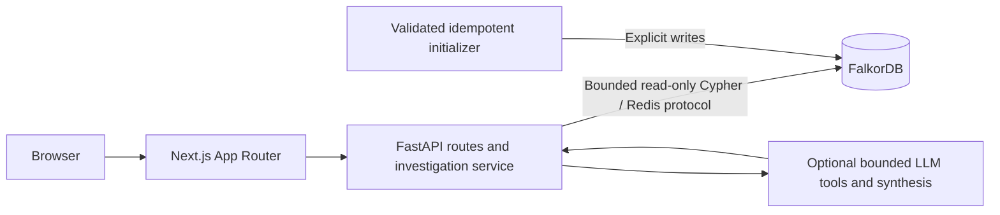

# System overview

Canonical design: [architecture](../ARCHITECTURE.md),
[target graph model](../GRAPH_SCHEMA.md), and [ordered acceptance checks](../TASKS.md).
Current implementation status: [foundation review](../FOUNDATION_REVIEW.md).

Stage 1 now has production Docker images, pinned FalkorDB 6.0.2, lifecycle-owned
bounded graph I/O, actual-query readiness, strict settings, and verified restart/
replacement persistence. Next 16.4.0 / React 19.3.0 run on digest-pinned Node 24;
the UI remains a static scaffold with an honest planned-state badge. Current
lint tooling compatibility/advisory limitations are recorded in the review.

Stage 1 initialization creates only an empty graph and reports infrastructure
scope with `demo_data_loaded: false`. Domain schema/seed reconciliation,
investigation, grounded AI, and interactive evidence paths remain later stages.
The target preserves FalkorDB, FastAPI, Next.js, and Docker Compose. No automatic
rollback, developer contact, streaming, or cause/fix writeback is in MVP scope.
