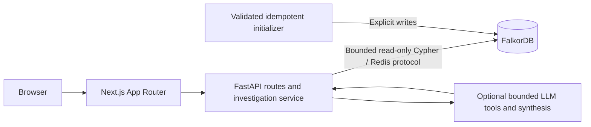

# System overview

Canonical design: [architecture](../ARCHITECTURE.md),
[target graph model](../GRAPH_SCHEMA.md), and [ordered acceptance checks](../TASKS.md).
Current implementation status: [foundation review](../FOUNDATION_REVIEW.md).

The baseline has a static frontend, root/health routes, graph templates, and
Compose scaffolding. Investigation, truthful readiness, nine-label reconciliation,
initialization, AI, and interactive paths remain planned. Next 14 is currently
locked and must be upgraded to a supported patched version. Driver I/O currently
blocks an async route and must move to supported async APIs or bounded workers.

The target preserves FalkorDB, FastAPI, Next.js, and Docker Compose. All essential
dependency/time-window/historical reasoning runs in Cypher. No automatic rollback,
developer contact, streaming, or cause/fix writeback is part of the MVP.
