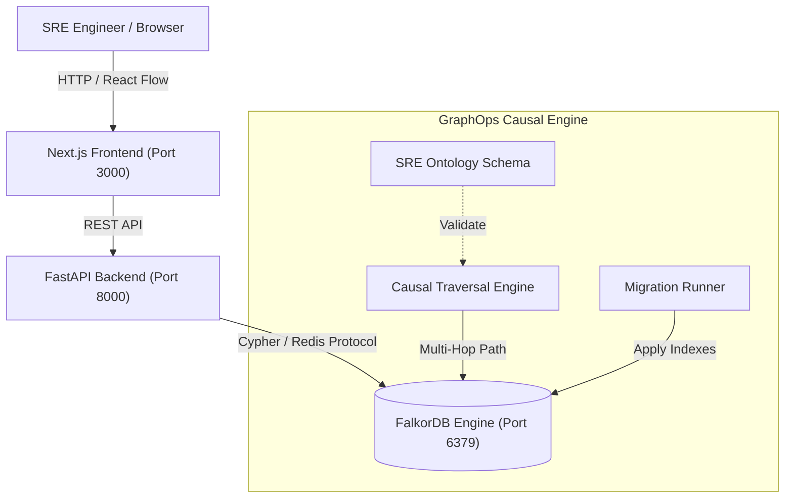

# System Architecture Overview

## Component Breakdown

1. **Frontend (`/frontend`)**:
   - Built with Next.js 14 App Router, React 18, and TypeScript.
   - Interactive topology visualization highlighting microservice dependency paths and culprit deployments during active outages.

2. **Backend (`/backend`)**:
   - Asynchronous FastAPI application managing connection pooling to FalkorDB via `falkordb-py`.
   - Multi-hop Cypher queries for blast-radius calculation, candidate culprit isolation within temporal windows, and historic RCA pattern matching.

3. **Graph Engine (`/graph` & FalkorDB Container)**:
   - High-performance C-based Graph engine using OpenCypher over Redis protocol (port 6379).
   - Domain ontology strictly adhering to the 8 SRE nodes and 6 causal relationships defined in [AGENTS.md](file:///Users/rauneetsingh/Developer/Graphops/AGENTS.md).
